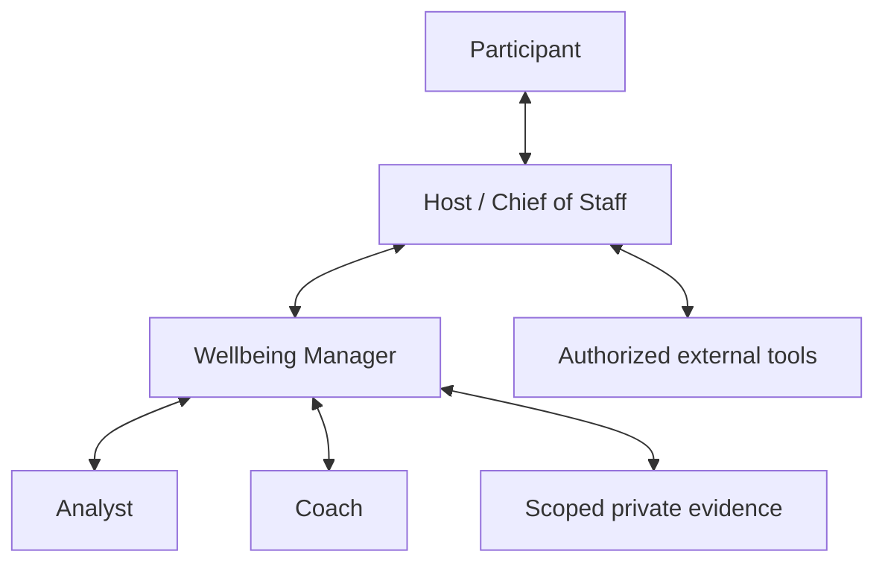
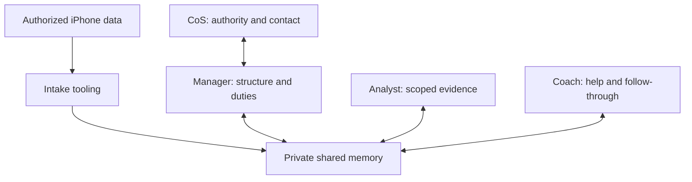

# Pilot architecture

This package turns the documented Wellbeing team into a portable initial trial. The host assistant—Dot, Grok, or another capable assistant—takes the Chief of Staff role previously called ELHAM. The participant speaks to that host. The three Wellbeing roles remain an experimental division of responsibility, not a claim that three agents outperform one.

## Responsibilities

| Role | Owns | Typical input | Result | Does not own |
|---|---|---|---|---|
| Participant | Goals, data, consent, preferences and consequential decisions | Useful explanation of choices | A chosen goal and bounded authority | Managing internal agents |
| Chief of Staff / host | Normal conversation, broader authorized context, attention and external execution | Participant request or Manager packet | A useful response, a decision request, or a verified authorized action | Treating every Wellbeing message as a notification |
| Manager | Coherence, priorities, delegation, conflicts and closure | Scoped question plus current charter | Decision-ready synthesis and next owner | Inventing health findings or becoming the Chief of Staff |
| Analyst | Reliable and revisable understanding | Relevant observations and provenance | Observation, uncertainty, hypotheses, limitations | Diagnosis or choosing the participant's goals |
| Coach | Feasible help and follow-through | Chosen goal and sufficient valid context | Optional small experiment, barrier review, next step | Assuming a recommendation was accepted or executed |

Each role can inspect, reason, ask for relevant evidence, revise, and close its own work. Roles are not a mandatory sequence. An analytical question may finish without the Coach. An agreed habit may be reviewed by the Coach using existing evidence. The Manager may reuse an adequate prior answer. Sleep, nutrition, activity and recovery are skills or subject areas, not automatic reasons to create more agents.

The arrows permit questions and corrections as well as reports. They do not grant access. Every transfer remains subject to the participant's declared purpose and recipients.

## Two execution modes

| Layer | Conversation-only host | Host with tools and optional Python harness |
|---|---|---|
| Reasoning | Host follows the role instructions in one conversation | Host may create real subagents through a verified capability |
| Role identity | Explicitly described as virtual roles | Record actual agent identifiers only after creation succeeds |
| State | Session record; participant saves an export if durable memory is unavailable | Private local state or an explicitly chosen private host store |
| Data | Participant supplies a minimum relevant summary | Normalized JSON input in the reference CLI; host-mapped exports or existing connectors only after capability and permission checks |
| Time | Work when the participant returns | Scheduling only if the host really supports it and the participant selects it |
| Python | Not required | Deterministic reference CLI for state, evidence, packets and lifecycle controls |

The Python runtime is not an LLM, an agent server, a notification worker, or a background health monitor. It does not log into Dot/Grok, provision cloud resources, connect to Apple Health, or send messages. The host supplies conversational judgment and any actual agent execution. The reference runtime supplies inspectable state transitions and checks; it must not be presented as evidence of an end-to-end hosted deployment.

Virtual roles share one host context. CLI output also passes through its invoking host. Role recipient lists do not create technical isolation from that host; the participant's scope must cover this actual route. Do not promise hidden specialist-only data inside a conversation the Chief of Staff can read.

Start with [START-HERE](../START-HERE.md). Host behavior is defined in [the self-contained starter](../CHAT-STARTER.md), [capability checks](../adapters/host-capabilities.md), and [the role registry](../agents/registry.json). Actual local commands are in [runtime.md](runtime.md).

## Agent creation and ongoing management

[The team blueprint](../agents/team-blueprint.json) specifies each role's mission, objectives, responsibilities, skill files, inputs, outputs, capability needs, allowed actions and reporting contract. [The orchestration playbook](orchestration-playbook-fa.md) turns that definition into the host's operational procedure. A skill path is useful only after the host actually loads its instructions into the selected role; it is not evidence of a separately installed skill.

The host owns this lifecycle:

| Operation | Required result |
|---|---|
| Prepare role | Select the blueprint, current skill versions and only relevant authorized capabilities |
| Create or select instance | Use a real host tool when available; record its real ID and limitations, or explicitly use a virtual role |
| Assign work | Give the role a concrete objective, minimum context, action limits, expected output, owner and completion condition |
| Dispatch | Record an actual host operation/acknowledgement separately from a locally prepared task |
| Receive report | Preserve evidence references, unknowns, work performed, blockers and claimed status |
| Verify | Manager or CoS checks the result against the task and authority; return incomplete or unsupported reports for revision |
| Present or defer | CoS communicates useful results according to attention preferences and records the decision |
| Continue or close | Keep the next owner and checkpoint clear; close completed work, stop revoked work, and retire unnecessary instances through actual tools |

Use [task contracts](../templates/task-contract.json), [task reports](../templates/task-report.json) and [the instance registry](../templates/agent-instance-registry.json) as host records. These templates do not dispatch anything. The reference runtime's task ledger, where used, records preparation and operator-supplied evidence of actual host operations; it does not call an agent platform. A specialist's “done” statement is not automatic verification. A status field is not a process-control mechanism.

Repeated management should reduce the participant's burden: do not ask them to approve routine scoped reasoning or route reports between agents. Ask only for a material missing goal, scope or consequential decision. Preserve unresolved or failed tasks honestly rather than manufacturing a successful report.

## Processing contract

1. The host reads its actual capabilities and existing authorized knowledge. A missing capability, access failure, unavailable source and empty source are different states.
2. It identifies the participant's present goal and closes only the missing decisions needed for useful work. Consent to named data and recipients is not inferred from a general wish to improve wellbeing.
3. The Manager routes a bounded task to only the roles needed. A packet contains the question, goal, relevant evidence, evidence dates, uncertainty, allowed use and expected output—not the participant's entire history.
4. The Analyst separates direct observations, participant-confirmed facts and hypotheses. A repeated hypothesis is still a hypothesis. A calendar event is a plan, not proof that an activity occurred.
5. The Coach proposes an appropriate, optional next step within authority. Broader lifestyle judgment remains contextual; the package does not prescribe universal sleep targets, medical thresholds or reporting frequency.
6. The Manager resolves disagreements or records uncertainty and returns one useful result to the host. The host decides how to present it within the participant's attention preferences.
7. Follow-through records delivery, acceptance/execution, and observed outcome independently. No response is not consent; improvement does not establish execution or causality.

## Authority and attention

The charter separates permission to read, process, retain, share and act. Existing valid consent remains valid within its scope; routine work does not need repeated approval. A new purpose, source, recipient or consequential action needs the corresponding decision. See [privacy and safety](privacy-and-safety.md).

Internal work and user-facing notifications are separate. A participant may choose on-demand help, a review cadence, or a bounded proactive trial. Quiet hours, delivery channel, a message budget and the treatment of important concerns are participant choices. Neither a fixed daily report nor invisible monitoring is enabled by downloading the package. “Do not tell me this again” must be interpreted in context: suppress a message, stop a topic, stop processing, or revoke a source are distinct operations.

## Adapter boundary

| Source/action | Pilot route | What a production adapter must add |
|---|---|---|
| Self-report | Short participant statement or documented input file | Provenance, correction, retention and a clear subjective label |
| Wearable / Apple Health / WHOOP | Minimum selected export or summary when the participant chooses | Actual authentication, metric/unit mapping, time zones, freshness, deduplication, revocation and verified deletion |
| Calendar | Participant-provided context or already-authorized read capability | Separate read/write grants, event versus completion semantics, retry/idempotency and a returned operation receipt |
| Other people or agents | Draft or scoped packet only | Named recipients, separate sharing authority, least data and confirmed delivery |
| Reminders | On-demand fallback; real host scheduling only if available | Durable scheduler, local time zone, quiet hours, deduplication, cancellation and observed delivery |

The initial release does not promise these production integrations. A host adapter is a capability and behavior contract, not an undocumented vendor API implementation. A connector failure must remain visible as a limitation; it must not become a fabricated empty-data success.

## Shared cloud memory within the existing roles

Manager owns the design and operation of participant-specific Sheets memory, including
structure, duty assignments and change history; all roles record their scoped actions
and exchanges. CoS supplies valid authority/capabilities and normal participant contact.
The intake worker is tooling, not an automatically added agent. Raw shortcut records,
findings and plans remain distinct and linked. Runtime telemetry complements actor
reports. Use [the contract](shared-memory/README.md) and [acceptance](shared-memory/acceptance.md).
The local CLI single-writer rule below remains local; this update implements no cloud adapter.

Arrows show possible scoped access, not a mandatory sequence or security boundary.

## State and evidence

Keep the public package immutable during a participant trial. Store private participant records outside the Git checkout; never commit them or attach them to public issues. The minimum useful state contains the active goal, consent and authority, relevant dated observations, open tasks, proposal status, feedback and the next agreed checkpoint. See [runtime.md](runtime.md) for the implemented local representation and commands, and [private-session.md](../templates/private-session.md) for the conversational representation. These representations are separate contracts, not interchangeable files.

A stop or revocation must affect future work immediately. Deletion must cover the selected store's records and derived material according to that store's actual capability. Local deletion cannot promise removal from provider logs, earlier chat messages, backups or exports held elsewhere. An audit receipt should say what was deleted and what remains beyond the operation's control.

The reference CLI performs retention cleanup on invocation, persisting it after a successful operation. It has no background cleanup worker and does not promise physical erasure exactly at a retention deadline. An inactive or failed invocation must not be confused with verified cleanup.

## What this trial must establish

The trial asks whether this team helps a real participant with acceptable effort, uncertainty and interruption. Automated tests establish reference-runtime behavior; conversational evaluation establishes host behavior. Neither establishes clinical efficacy. [Acceptance tests](acceptance-tests.md) define both levels and keep implementation, synthetic verification and live observation separate.
