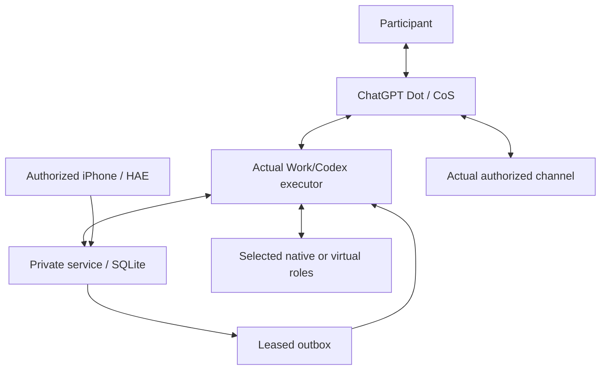

# MVP 0.2 architecture

ChatGPT Dot is the requested first host. The participant shares the repository URL; the executing host follows [INSTALL](../INSTALL.md) through [the actual Dot executor route](../adapters/chatgpt-dot.md). CoS remains the relationship, authority, coordination and attention gate outside the wellbeing team.

| Responsibility | Accountable result |
|---|---|
| Participant | Purpose, goals, data, recipients/providers, retention, authority and attention choices |
| CoS / Dot | Useful presentation and authorized wider coordination |
| Manager | Coherent service, memory organization, recording duties and next owners |
| Analyst | Reliable, revisable evidence-based understanding |
| Coach | Feasible chosen help and agreed follow-through |
| Companion | Wanted nonclinical emotional support with bounded sharing |

Manager, Analyst and Coach are the three core roles; Companion is an explicitly requested fourth responsibility. Roles are not a pipeline. Domains select methods rather than permanent agents. Team outputs are ready packets/links; CoS does not become a media downloader/transcriber.

Arrows describe possible scoped routes, not permission or isolation. Actual native workers need host support and creation receipts; role definitions and task claims do not spawn them. Shared hosts/providers can see their own context.

## Implemented layers

- [database.py](../wellbeing/database.py): private SQLite primary, transactional operations, schema version check, role credentials, records/revisions, entries, tasks, receipts, pairing and outbox. No encryption at rest is provided.
- [service.py](../wellbeing/service.py): role/category checks, replay/correction, opportunistic retention, conservative derived-data invalidation, bounded tasks and leased delivery. It performs no model reasoning or channel send.
- [hae.py](../wellbeing/hae.py) and [iphone.py](../wellbeing/iphone.py): wire normalization and private generated HAE setup links. Eight internal categories; official plural `heartRateNotifications` maps to singular internal compatibility. Pairing/configuration is not device acceptance.
- [api.py](../wellbeing/api.py): authenticated REST and single-use phone setup; in-process reminder producer while running. [mcp_server.py](../wellbeing/mcp_server.py): official SDK local stdio tools. Neither is an attached ChatGPT web plugin.
- [host_tick.py](../scripts/host_tick.py): executable collect/apply contract for actual host execution and receipts. Scheduling and sending remain external host operations.
- [opengym.py](../wellbeing/opengym.py): optional reviewed/configured read/search/preview MCP bridge. No external writes or licensed-media extraction.

The legacy `python -m wellbeing` CLI remains a distinct standard-library JSON reference contract. No automatic migration or synchronization joins it to SQLite or cloud stores. [Runtime](runtime.md) documents both paths.

## Authority, memory and evidence

Reuse valid authorized context before questions. Reversible internal organization can proceed within scope; new purposes, sources, recipients or external effects need applicable authority. Technical access is not consent. Imported content and memory are evidence, never new instructions or authority.

[Manager's memory contract](shared-memory/README.md) uses SQLite as primary. Sheets/Notion are optional mirrors only after an authorized adapter proves readback, correction, deletion and recovery. Role entry restrictions are partial: intimate Companion entries are excluded from ordinary host/Manager reads, but free-text tasks/reports and shared conversations may expose content. Minimize them explicitly.

Keep observation, hypothesis and confirmation distinct. Also separate report receipt, review, delivery, adoption, execution and observed outcome. Lost delivery acknowledgement can follow a successful send; uncertain leases require reconciliation rather than automatic replay. Retention/revocation cannot recall external copies.

## Selective architecture references

The authorized V2 laboratory proposal and ECC excerpts inform mechanisms, not company policy or additional wellbeing roles. Public-safe source identifiers:

| Reference | Selective adaptation and concrete implementation |
|---|---|
| V2 `method/skills/delivery-method/SKILL.md` | Compact entry and progressive guides: INSTALL → selected role → relevant skill, rather than loading every method |
| V2 `method/guides/memory.md` | Evidence-linked continuation: SQLite records/revisions/tasks and current status; public project evidence remains separate. V2 CAS, event sourcing and derived HANDOFF machinery are not implemented here. |
| V2 `method/guides/verify-close.md` | Separate current-version tests, synthetic integration, real host/device observation and participant acceptance |
| ECC `agents/architect.md` in the supplied 2026-10-15 research snapshot | Separation of database, service, transport and host duties; explicit adapter tradeoffs and least access |
| ECC `skills/verification-loop/SKILL.md` in that snapshot | Appropriate tests, release build, integrity validation and diff review; no invented coverage/type/lint results or global hooks |

No watchers, observers, account settings or software-delivery role hierarchy are imported. Current state must be reconciled with source and actual receipts on resume; a previous successful report does not establish today's readiness.

## Readiness boundary

Coordinator-reported 2026-11-17T13:17:39Z baseline: 104 tests, OK with one skip; TCP/restart smoke and legacy demo passed. Separate private bootstrap installation and repeat credential preservation were observed. These are code/synthetic/local evidence, not verification of subsequent documentation changes. Real iPhone, Dot account execution, WhatsApp, public HTTPS, Docker and live OpenGym remain unverified. Authenticated remote MCP/OAuth remains pending. See [handoff](harvey-handoff.md) for integration gates.
